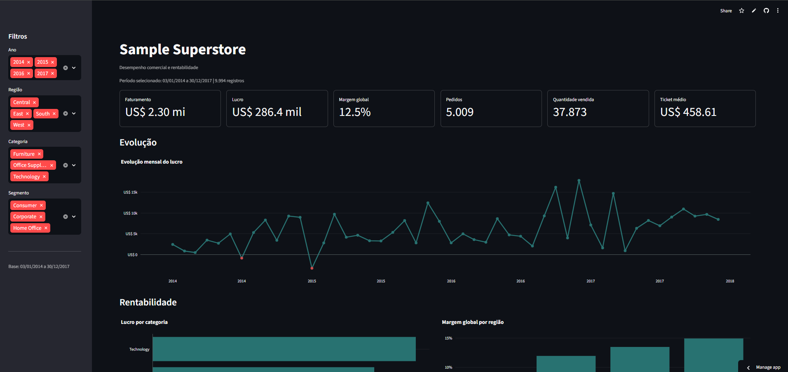

# Análise de Vendas - Sample Superstore

Projeto de análise de dados desenvolvido para investigar o desempenho comercial
da Sample Superstore, identificando padrões de faturamento, lucro, margem,
descontos, categorias, regiões e segmentos de clientes.

O projeto percorre todo o processo analítico: exploração inicial no Excel,
limpeza e análise com Python, visualização de dados e construção de um dashboard
interativo com Streamlit.

## Dashboard

O dashboard interativo foi desenvolvido com Streamlit e Plotly para permitir
a exploração dos resultados por ano, região, categoria e segmento de clientes.

A aplicação apresenta:

- faturamento total;
- lucro total;
- margem global;
- quantidade de pedidos;
- quantidade vendida;
- ticket médio;
- gráficos de evolução temporal e rentabilidade;
- tabela detalhada e download dos dados filtrados.

**Dashboard online:** [Acessar o dashboard interativo](https://sample-superstore-dashboard-vendas.streamlit.app/)
[](https://sample-superstore-dashboard-vendas.streamlit.app/)

## Problema de Negócio

Apesar de apresentar resultado acumulado positivo, a Sample Superstore possui
diferenças importantes de desempenho entre períodos, categorias, regiões,
segmentos e faixas de desconto.

O objetivo da análise é identificar onde o faturamento não está sendo convertido
em lucro de forma eficiente, localizar os principais fatores de prejuízo e
transformar os resultados em informações que apoiem decisões comerciais.

## Perguntas de Negócio

- Como faturamento, lucro e margem evoluíram entre 2014 e 2017?
- Quais períodos apresentaram os piores resultados?
- Quais categorias e subcategorias reduzem a rentabilidade do negócio?
- Qual é o impacto das diferentes faixas de desconto sobre o lucro?
- Qual região apresenta o melhor desempenho e qual possui a menor eficiência?
- Qual segmento gera o maior resultado e qual apresenta a melhor margem?

## Principais Indicadores

| Indicador | Resultado |
|---|---:|
| Faturamento total | US$ 2,30 milhões |
| Lucro total | US$ 286,40 mil |
| Margem global | 12,47% |
| Pedidos únicos | 5.009 |
| Quantidade vendida | 37.873 unidades |
| Ticket médio | US$ 458,61 |

## Principais Insights

- O lucro aumentou em todos os anos. Em 2015, cresceu 24,37% mesmo com uma redução de 2,83% no faturamento.
- `Technology` apresentou a melhor margem entre as categorias, com 17,40%.
- `Furniture` teve margem de apenas 2,49%, principalmente pelos prejuízos de `Tables` e `Bookcases`.
- Os descontos agressivos geraram aproximadamente US$ 99,56 mil de prejuízo.
- `West` apresentou o melhor desempenho regional, enquanto `Central` teve a menor margem, com 7,92%.
- `Consumer` liderou em faturamento e lucro, mas `Home Office` foi o segmento mais eficiente, com margem de 14,03%.
- Janeiro de 2015 foi o período mais crítico, com aproximadamente US$ 3,28 mil de prejuízo e margem de -18,05%.

## Recomendações de Negócio

- Revisar a política de descontos agressivos, que apresentou lucro e margem negativos.
- Investigar preços, custos e descontos das subcategorias `Tables` e `Bookcases`.
- Avaliar os fatores que reduzem a eficiência financeira da região `Central`.
- Preservar e estudar as práticas associadas ao desempenho de `Technology`, especialmente `Copiers`.
- Monitorar faturamento, lucro e margem em conjunto para evitar decisões baseadas apenas no volume de vendas.

## Tecnologias Utilizadas

| Tecnologia | Aplicação no projeto |
|---|---|
| Excel | Exploração inicial, tabelas dinâmicas e primeiro dashboard |
| Python 3.13 | Limpeza, análise e automação |
| Pandas | Manipulação, agregação e validação dos dados |
| Matplotlib e Seaborn | Visualizações exploratórias |
| Plotly | Gráficos interativos do dashboard |
| Streamlit | Construção da aplicação interativa |
| Jupyter Notebook | Exploração, análise final e visualizações |
| Git e GitHub | Versionamento e organização do desenvolvimento |

## Estrutura do Projeto

```text
projetoanalisevendas-SAMPLE-SUPERSTORE/
├── dados/
│   ├── bruto/
│   │   ├── Sample - Superstore.csv
│   │   └── analisesample-superstore.xlsx
│   └── tratado/
│       └── superstore_tratado.csv
├── dashboard/
│   └── app.py
├── docs/
│   ├── metodologia_aprendizado.md
│   ├── perguntas_e_insights.md
│   └── perguntas_e_insights/
│       ├── exploracao_inicial.md
│       └── analise_final.md
├── notebooks/
│   ├── exploracao.ipynb
│   ├── analise_final.ipynb
│   └── visualizacoes.ipynb
├── src/
│   └── limpeza.py
├── .gitignore
├── devlog.md
├── README.md
└── requirements.txt
```

## Como Executar o Projeto

### 1. Clonar o repositório

```bash
git clone https://github.com/Mattanatecn/projetoanalisevendas-SAMPLE-SUPERSTORE.git
cd projetoanalisevendas-SAMPLE-SUPERSTORE
```

### 2. Criar e ativar o ambiente virtual

No Windows PowerShell:

```powershell
python -m venv .venv
.\.venv\Scripts\Activate.ps1
```

### 3. Instalar as dependências

```powershell
python -m pip install -r requirements.txt
```

### 4. Executar o dashboard

```powershell
streamlit run dashboard/app.py
```

O Streamlit informará no terminal o endereço local para abrir a aplicação no navegador.

## Fonte dos Dados

O projeto utiliza o [Sample Superstore Dataset](https://www.kaggle.com/datasets/vivek468/superstore-dataset-final), disponibilizado no Kaggle.

A base original foi preservada em `dados/bruto/`. O processo de limpeza gera `dados/tratado/superstore_tratado.csv`, utilizado pelos notebooks e pelo dashboard.

## Metodologia

O desenvolvimento começou com uma exploração manual no Excel e avançou progressivamente para Pandas, limpeza dos dados, análise final, visualizações e Streamlit.

Essa abordagem priorizou a formulação de perguntas, a interpretação dos resultados e a tentativa manual antes da automação. O roteiro completo está documentado em [Metodologia de Aprendizado](docs/metodologia_aprendizado.md).

## Documentação da Análise

- [Exploração inicial](docs/perguntas_e_insights/exploracao_inicial.md)
- [Análise final](docs/perguntas_e_insights/analise_final.md)
- [Perguntas e insights](docs/perguntas_e_insights.md)
- [Histórico de desenvolvimento](devlog.md)
